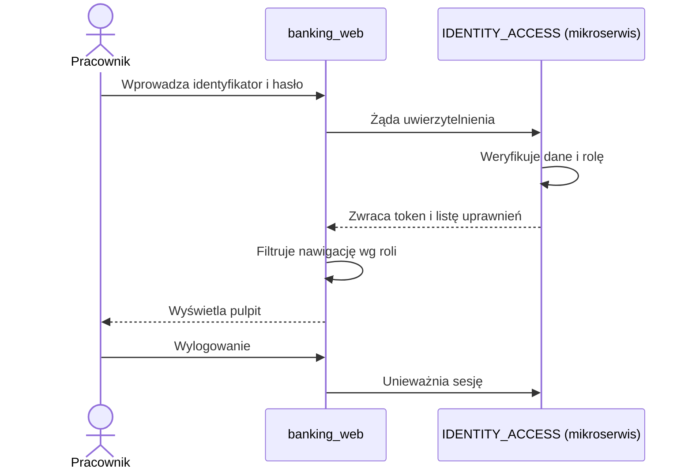
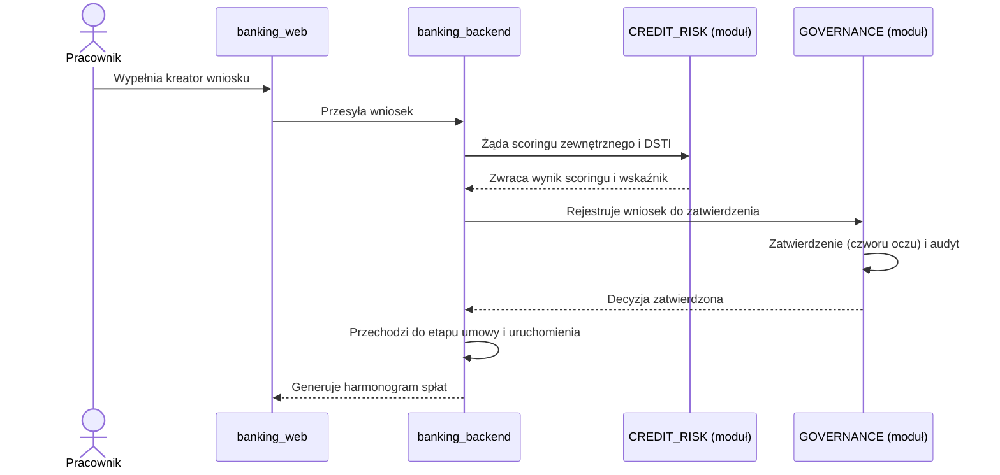
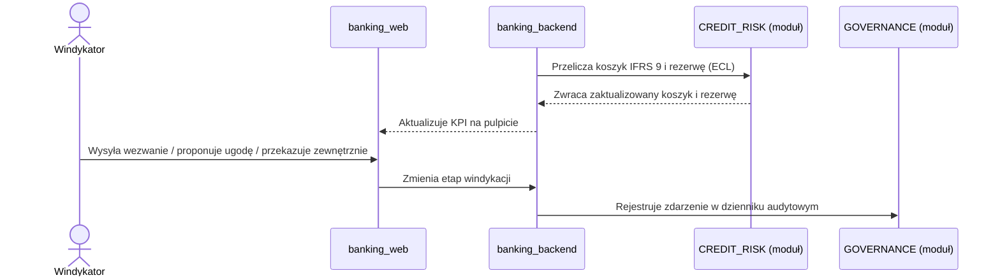
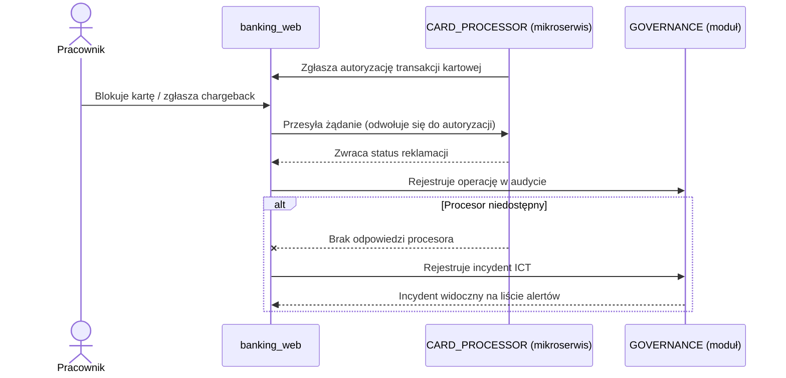
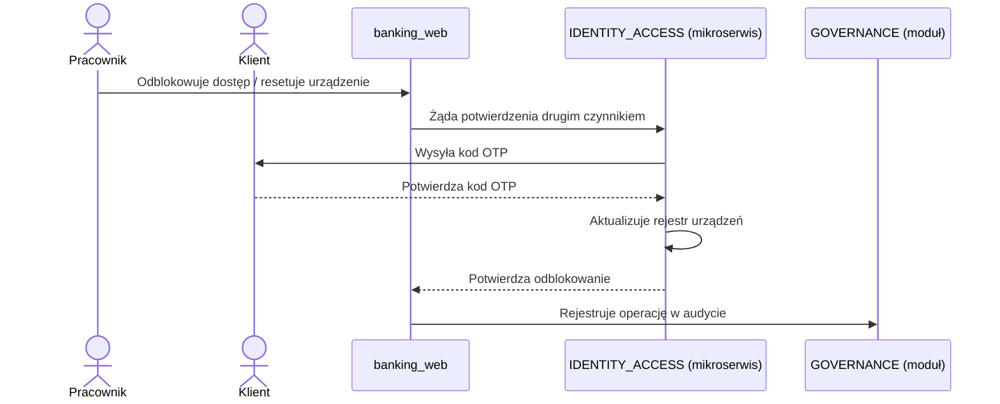
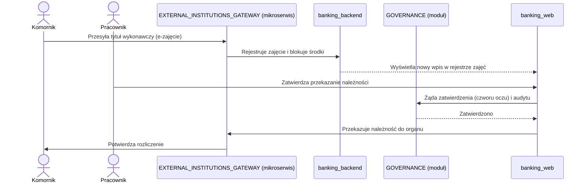
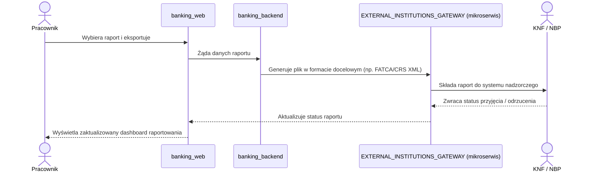
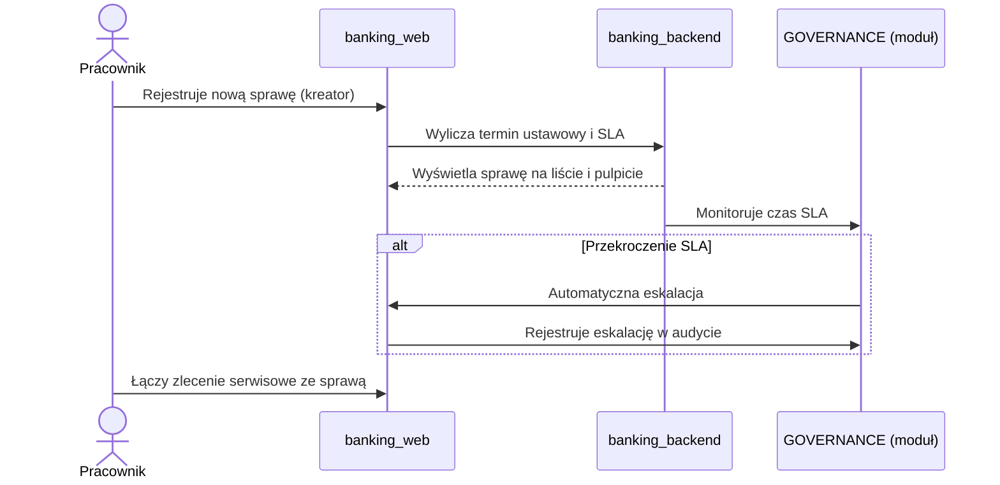

# Funkcje systemu banking_web

Zestawienie funkcji mających solidne pokrycie w UI (ekran + podłączony handler), zgrupowane według nawigacji. Każda funkcja ma identyfikator `[XXX-NN]` używany w sekcji standardów.

## Wspólne / Konto

- **[ACC-01]** Logowanie identyfikatorem pracownika (format `PRC-00000`) i hasłem
- **[ACC-02]** Wybór konta demo z listy (auto-wypełnienie formularza logowania)
- **[ACC-03]** Rejestracja pracownika (dane osobowe, pracownicze, kompetencje branżowe, konto) — jeden formularz z sekcjami
- **[ACC-04]** Wylogowanie
- **[ACC-05]** Przełączanie trybu jasny/ciemny
- **[ACC-06]** Przełączanie języka PL/EN

## Pulpit (Dashboard)

- **[DSH-01]** Podgląd KPI: aktywne kredyty, portfel kredytowy, wydane karty, NPL, LCR, NSFR, otwarte sprawy, zaległości windykacyjne
- **[DSH-02]** Wykres trendu portfela kredytowego w czasie
- **[DSH-03]** Wykres portfela według produktu
- **[DSH-04]** Lista ostatnich spraw klientów
- **[DSH-05]** Lista alertów regulacyjnych

## Kredyty i pożyczki

- **[KRD-01]** Lista wniosków kredytowych z wyszukiwaniem i filtrem segmentu (detaliczny/biznesowy)
- **[KRD-02]** Szczegóły wniosku: etapy cyklu życia, kwota wnioskowana/przyznana, wynik scoringu, DSTI
- **[KRD-03]** Przesuwanie wniosku do kolejnego etapu cyklu życia
- **[KRD-04]** Harmonogram spłat (kapitał, odsetki, status raty)
- **[KRD-05]** Nowy wniosek kredytowy — kreator 4-etapowy (wnioskodawca → produkt i kwota → scoring i DSTI → podsumowanie)

## Karty płatnicze

- **[KRT-01]** Lista kart płatniczych (posiadacz, numer, organizacja, limity, status)
- **[KRT-02]** Blokada / odblokowanie karty
- **[KRT-03]** Zgłoszenie chargebacku (symulacja)
- **[KRT-04]** Lista ostatnich autoryzacji karty

## Ryzyko kredytowe

- **[RSK-01]** Zestawienie zabezpieczeń i wycen (typ zabezpieczenia, wartość wyceny, LTV, rating klienta, koszyk IFRS 9, rezerwa)

## Bankowość elektroniczna

- **[EBK-01]** Lista użytkowników e-banking (login, kanał, limit dzienny, ostatnie logowanie, uprawnienia, status dostępu)
- **[EBK-02]** Odblokowanie dostępu użytkownika
- **[EBK-03]** Reset urządzenia mobilnego (tylko dla kanału mobilnego)

## Kanał kontaktu

- **[KKT-01]** Widok 360 klienta (produkty, ryzyko, sprawy)
- **[KKT-02]** Lista zleceń serwisowych (dyspozycji) z powiązaną sprawą
- **[KKT-03]** Historia kontaktów wg kanału
- **[KKT-04]** Czat z klientem (symulacja komunikatora)

## Zajęcia komornicze

- **[ZJC-01]** Lista zajęć komorniczych (komornik, sygnatura, kwoty, status)
- **[ZJC-02]** Przekazanie należności do organu (tylko dla zajęć aktywnych)
- **[ZJC-03]** Rejestracja nowego zajęcia — kreator 3-etapowy (komornik i sprawa → kwoty → podsumowanie)

## Raportowanie

- **[RPT-01]** Lista raportów regulacyjnych z filtrem odbiorcy (KNF/NBP/BFG/FATCA-CRS)
- **[RPT-02]** Eksport listy raportów do CSV
- **[RPT-03]** Dashboard raportowania: KPI (łącznie, przeterminowane, najbliższy termin, zaakceptowane), wykres wg odbiorcy, wykres wg statusu

## Sprawy klientów

- **[CAS-01]** Lista spraw z priorytetem, terminem ustawowym i pozostałym czasem SLA
- **[CAS-02]** Eskalacja sprawy
- **[CAS-03]** Rejestracja nowej sprawy — kreator 3-etapowy (dane sprawy → priorytet i terminy → podsumowanie)

## Windykacja

- **[WND-01]** Lista spraw windykacyjnych (dni opóźnienia, kwota zaległa, etap)
- **[WND-02]** Wysłanie wezwania do zapłaty
- **[WND-03]** Zaproponowanie ugody
- **[WND-04]** Przekazanie do windykacji zewnętrznej

## Uwaga

Wszystkie akcje zmieniające status (blokady, eskalacje, transfery, wysyłki) operują na danych mockowych w pamięci — brak integracji z rzeczywistym backendem.

---

# Propozycje standardów enterprise do zaimplementowania / zasymulowania

Poniższe standardy są przyporządkowane do funkcji, które już istnieją w UI i mogłyby je realnie wspierać lub ograniczać. Tam, gdzie standard wymaga danych lub procesu, których UI nie generuje samodzielnie (np. decyzja zewnętrznego systemu, bazy referencyjnej), zaznaczono potrzebę dodatkowego mockowego serwisu.

## Bezpieczeństwo dostępu i kontrola operacji

**RBAC (Role-Based Access Control)**

- Co zaimplementować/zasymulować: ograniczenie widoczności modułów nawigacji i akcji (blokady, eskalacje, zmiany etapu) do roli przypisanej do zalogowanego konta.
- Wspierane funkcje: [ACC-01](#acc-01), [ACC-02](#acc-02) (6 ról demo: administrator, doradca kredytowy, analityk ryzyka, windykator, konsultant kanału kontaktu, compliance/AML)
- Mockowy serwis: tak — serwis roli/uprawnień mapujący rolę konta demo na dostępne moduły i akcje (obecnie rola jest tylko etykietą, nie wpływa na UI).

**Zasada "czworu oczu" (maker-checker / dual control)**

- Co zaimplementować/zasymulować: rozdzielenie ról wykonawcy i zatwierdzającego przy decyzjach o istotnym ryzyku — przejście wniosku kredytowego do etapu decyzji, przekazanie należności komorniczej do organu.
- Wspierane funkcje: [KRD-03](#krd-03), [ZJC-02](#zjc-02)
- Mockowy serwis: tak — serwis zatwierdzeń (approval queue) symulujący drugiego decydenta i status "czeka na zatwierdzenie".

**Dziennik audytowy (audit trail)**

- Co zaimplementować/zasymulować: rejestr kto/kiedy/jaką akcję wykonał dla wszystkich operacji zmieniających status (blokada karty, eskalacja sprawy, zmiana etapu wniosku, transfer środków).
- Wspierane funkcje: [KRD-03](#krd-03), [KRT-02](#krt-02), [EBK-02](#ebk-02), [ZJC-02](#zjc-02), [CAS-02](#cas-02), [WND-02](#wnd-02), [WND-03](#wnd-03), [WND-04](#wnd-04)
- Mockowy serwis: tak — serwis logowania zdarzeń z widokiem historii (częściowo pokrewny istniejącej historii kontaktów [KKT-03](#kkt-03), ale dla operacji systemowych, nie kontaktowych).

## Karty płatnicze

**PCI DSS — maskowanie numeru karty (PAN masking)**

- Co zaimplementować/zasymulować: numer karty jest już wyświetlany w formie zamaskowanej; standard formalizuje wymóg, by maskowanie dotyczyło każdego miejsca prezentacji numeru (lista, szczegóły, eksport).
- Wspierane funkcje: [KRT-01](#krt-01)
- Mockowy serwis: nie — już zrealizowane częściowo (`maskedNumber`), do utrzymania jako zasada przy rozwoju funkcji.

**ISO 8583 — format komunikatów autoryzacyjnych**

- Co zaimplementować/zasymulować: lista autoryzacji karty mogłaby prezentować pola analogiczne do komunikatu ISO 8583 (kod odpowiedzi, kod MCC akceptanta, identyfikator procesora) jako symulację odpowiedzi procesora płatności.
- Wspierane funkcje: [KRT-04](#krt-04)
- Mockowy serwis: tak — mock procesora płatności generujący autoryzacje ze statusami/kodami odpowiedzi zgodnymi z konwencją ISO 8583.

**Kody przyczyn chargeback (Visa/Mastercard reason codes)**

- Co zaimplementować/zasymulować: zamiast samego zgłoszenia-symulacji, formularz chargebacku z wyborem kodu przyczyny (np. towar niedostarczony, transakcja nieautoryzowana) i statusem postępowania reklamacyjnego.
- Wspierane funkcje: [KRT-03](#krt-03)
- Mockowy serwis: tak — mock rejestru reklamacji kartowych ze statusami zgodnymi z cyklem chargeback (zgłoszenie → rozpatrzenie → rozstrzygnięcie).

## Kredyty i ryzyko kredytowe

**Rekomendacje KNF T i S (zdolność kredytowa, wskaźniki DSTI/LTV)**

- Co zaimplementować/zasymulować: walidacja wskaźnika DSTI przy wprowadzaniu wniosku z ostrzeżeniem/blokadą przy przekroczeniu poziomu uznawanego za bezpieczny dla danego segmentu klienta; analogicznie LTV dla zabezpieczeń.
- Wspierane funkcje: [KRD-02](#krd-02), [KRD-05](#krd-05), [RSK-01](#rsk-01)
- Mockowy serwis: nie — logika walidacyjna może być dodana lokalnie w formularzu/kreatorze; opcjonalnie mock tabeli progów granicznych per segment, jeśli progi mają być konfigurowalne.

**Wytyczne EBA dot. udzielania i monitorowania kredytów (loan origination and monitoring)**

- Co zaimplementować/zasymulować: formalizacja etapów cyklu życia wniosku (wniosek → scoring → analiza zdolności → decyzja → umowa → uruchomienie) jako zgodnych z referencyjnym procesem nadzorczym, z wymaganymi polami na każdym etapie.
- Wspierane funkcje: [KRD-02](#krd-02), [KRD-03](#krd-03), [KRD-05](#krd-05)
- Mockowy serwis: nie — rozszerzenie istniejącego modelu etapów.

**IFRS 9 — klasyfikacja do koszyków i rezerwy (ECL)**

- Co zaimplementować/zasymulować: reguła przenosząca pozycję między koszykami IFRS 9 na podstawie liczby dni opóźnienia/pogorszenia ratingu, z przeliczeniem rezerwy.
- Wspierane funkcje: [RSK-01](#rsk-01), [WND-01](#wnd-01)
- Mockowy serwis: tak — mock silnika kalkulacji rezerw (ECL engine), ponieważ obecnie koszyk i rezerwa są danymi statycznymi, a nie wynikiem reguły.

**Raport z biura informacji kredytowej (BIK / scoring zewnętrzny)**

- Co zaimplementować/zasymulować: krok w kreatorze wniosku kredytowego pobierający (symulowany) wynik scoringowy z zewnętrznego biura, zamiast ręcznego wpisania wyniku.
- Wspierane funkcje: [KRD-05](#krd-05)
- Mockowy serwis: tak — mock integracji z biurem informacji kredytowej zwracający wynik scoringowy i historię zapytań.

## Bankowość elektroniczna

**PSD2 — silne uwierzytelnienie klienta (SCA)**

- Co zaimplementować/zasymulować: symulacja drugiego czynnika uwierzytelnienia (np. kod OTP) przy odblokowaniu dostępu lub resecie urządzenia mobilnego, zamiast jednoetapowej akcji.
- Wspierane funkcje: [EBK-02](#ebk-02), [EBK-03](#ebk-03)
- Mockowy serwis: tak — mock serwisu OTP/uwierzytelniania wieloczynnikowego.

**Wiązanie urządzenia (device binding) i zarządzanie zaufanymi urządzeniami**

- Co zaimplementować/zasymulować: lista zarejestrowanych urządzeń mobilnych klienta z możliwością odwiązania, uzupełniająca obecny jednorazowy "reset urządzenia".
- Wspierane funkcje: [EBK-03](#ebk-03)
- Mockowy serwis: tak — mock rejestru urządzeń mobilnych powiązanych z użytkownikiem e-banking.

## Zajęcia komornicze

**Ochrona kwoty wolnej od zajęcia**

- Co zaimplementować/zasymulować: walidacja w kreatorze zajęcia, że kwota zablokowana/przekazana nie narusza kwoty wolnej od zajęcia (inny limit dla zajęć niealimentacyjnych i alimentacyjnych); ostrzeżenie przy próbie wprowadzenia niezgodnych wartości.
- Wspierane funkcje: [ZJC-03](#zjc-03), [ZJC-01](#zjc-01)
- Mockowy serwis: nie — reguła walidacyjna lokalna w kreatorze, oparta na wprowadzonych kwotach.

**Kanał e-zajęcia (elektroniczna wymiana z komornikami, np. system Ognivo)**

- Co zaimplementować/zasymulować: symulacja odebrania zajęcia drogą elektroniczną (automatyczne utworzenie wpisu w rejestrze zajęć na podstawie "odebranego" komunikatu) jako alternatywa dla ręcznej rejestracji przez kreator.
- Wspierane funkcje: [ZJC-01](#zjc-01), [ZJC-03](#zjc-03)
- Mockowy serwis: tak — mock bramki e-zajęć generujący przychodzące komunikaty o nowych tytułach wykonawczych.

## Raportowanie regulacyjne

**COREP/FINREP — sprawozdawczość nadzorcza**

- Co zaimplementować/zasymulować: rozszerzenie listy raportów o typy zgodne z zakresem COREP (adekwatność kapitałowa, w tym pochodne wskaźników LCR/NSFR z pulpitu) i FINREP (dane finansowe), z odwzorowaniem na istniejące statusy robocze/złożone/zaakceptowane.
- Wspierane funkcje: [RPT-01](#rpt-01), [DSH-01](#dsh-01)
- Mockowy serwis: nie — rozszerzenie danych mockowych listy raportów o typy COREP/FINREP.

**CRR — minimalne wskaźniki LCR i NSFR**

- Co zaimplementować/zasymulować: wizualne oznaczenie na pulpicie przekroczenia/zbliżenia się do minimalnego poziomu regulacyjnego wskaźników LCR i NSFR (próg 100% zgodnie z Basel III/CRR), zamiast neutralnej prezentacji liczby.
- Wspierane funkcje: [DSH-01](#dsh-01)
- Mockowy serwis: nie — reguła progowa nad istniejącymi danymi KPI.

**FATCA/CRS — automatyczna wymiana informacji podatkowych**

- Co zaimplementować/zasymulować: format eksportu zgodny ze strukturą wymaganą przez odbiorcę FATCA/CRS jako osobna opcja eksportu, odróżniona od ogólnego CSV.
- Wspierane funkcje: [RPT-01](#rpt-01), [RPT-02](#rpt-02)
- Mockowy serwis: tak — mock generatora plików XML w strukturze zgodnej ze standardem wymiany (obecny eksport CSV nie odwzorowuje wymaganego formatu).

**Elektroniczna brama sprawozdawcza (np. do systemu KNF/NBP)**

- Co zaimplementować/zasymulować: symulacja "złożenia" raportu do zewnętrznego systemu nadzorczego ze statusem odpowiedzi (przyjęto/odrzucono/błędy walidacji), zamiast lokalnej zmiany statusu.
- Wspierane funkcje: [RPT-01](#rpt-01)
- Mockowy serwis: tak — mock bramy sprawozdawczej zwracający opóźnioną odpowiedź o przyjęciu/odrzuceniu raportu.

## Sprawy klientów i reklamacje

**Ustawa o rozpatrywaniu reklamacji przez podmioty rynku finansowego**

- Co zaimplementować/zasymulować: w kreatorze sprawy — automatyczne wyliczenie terminu ustawowego (30 dni od zgłoszenia, z możliwością wydłużenia do 60 dni w sprawach szczególnie złożonych) na podstawie typu sprawy, zamiast ręcznego wpisania terminu; wizualne oznaczenie przekroczenia terminu analogiczne do istniejącego oznaczenia SLA.
- Wspierane funkcje: [CAS-01](#cas-01), [CAS-03](#cas-03)
- Mockowy serwis: nie — reguła wyliczająca termin na podstawie typu sprawy i daty zgłoszenia.

**SLA i eskalacja w obsłudze spraw**

- Co zaimplementować/zasymulować: automatyczna eskalacja sprawy przy przekroczeniu zdefiniowanego czasu SLA (obecnie eskalacja jest tylko ręczną akcją), z powiadomieniem analogicznym do istniejących toastów ostrzegawczych.
- Wspierane funkcje: [CAS-01](#cas-01), [CAS-02](#cas-02)
- Mockowy serwis: nie — reguła czasowa nad istniejącymi danymi SLA.

## Zgodność i ochrona danych (przekrojowe)

**RODO — minimalizacja i maskowanie danych osobowych**

- Co zaimplementować/zasymulować: maskowanie danych identyfikujących klienta (np. pełny PESEL/numer rachunku) w widokach listowych z możliwością odsłonięcia po dodatkowej akcji, analogicznie do maskowania numeru karty.
- Wspierane funkcje: [KKT-01](#kkt-01), [KRT-01](#krt-01)
- Mockowy serwis: nie — rozszerzenie istniejącego wzorca maskowania na inne dane osobowe.

**DORA — obsługa incydentów operacyjnych/ICT**

- Co zaimplementować/zasymulować: rejestr incydentów operacyjnych (np. niedostępność kanału e-banking, błąd procesora kart) widoczny jako dodatkowa lista alertów uzupełniająca istniejące alerty regulacyjne na pulpicie.
- Wspierane funkcje: [DSH-05](#dsh-05)
- Mockowy serwis: tak — mock rejestru incydentów ICT, ponieważ obecne alerty regulacyjne dotyczą tylko raportów, nie zdarzeń operacyjnych.

**WCAG — dostępność interfejsu**

- Co zaimplementować/zasymulować: audyt i uzupełnienie etykiet ARIA, kontrastu i obsługi klawiatury dla elementów interaktywnych (tabele, kreatory, menu użytkownika), jako wymóg jakościowy dla całego UI, nie pojedynczej funkcji.
- Wspierane funkcje: dotyczy całego systemu, w szczególności wieloetapowych kreatorów ([KRD-05](#krd-05), [ZJC-03](#zjc-03), [CAS-03](#cas-03))
- Mockowy serwis: nie — zmiana w warstwie prezentacji, bez potrzeby dodatkowego serwisu.

---

# Dodatkowe serwisy mockowe

Zestawienie wszystkich serwisów mockowych wskazanych w sekcji standardów jako wymagane ("Mockowy serwis: tak").

| title                        | description                                                                                                                      |
| ---------------------------- | -------------------------------------------------------------------------------------------------------------------------------- |
| `RBAC_mock`                  | Serwis roli i uprawnień kont użytkowników — mapuje rolę konta demo na dostępne moduły i akcje w UI.                              |
| `APPROVAL_QUEUE_mock`        | Serwis kolejki zatwierdzeń symulujący drugiego decydenta (zasada czworu oczu) dla decyzji kredytowych i egzekucyjnych.           |
| `AUDIT_LOG_mock`             | Serwis dziennika audytowego rejestrujący kto/kiedy/jaką akcję wykonał dla operacji zmieniających status.                         |
| `PAYMENT_PROCESSOR_mock`     | Mock procesora płatności generujący autoryzacje kart ze statusami/kodami odpowiedzi w konwencji ISO 8583.                        |
| `CHARGEBACK_REGISTRY_mock`   | Mock rejestru reklamacji kartowych z kodami przyczyn chargeback i statusami cyklu postępowania.                                  |
| `ECL_ENGINE_mock`            | Mock silnika kalkulacji rezerw (ECL) wyliczającego koszyk IFRS 9 i rezerwę na podstawie dni opóźnienia/ratingu.                  |
| `CREDIT_BUREAU_mock`         | Mock integracji z biurem informacji kredytowej (BIK) zwracający wynik scoringowy i historię zapytań.                             |
| `OTP_AUTH_mock`              | Mock serwisu OTP/uwierzytelniania wieloczynnikowego wspierający silne uwierzytelnienie klienta (PSD2 SCA).                       |
| `DEVICE_REGISTRY_mock`       | Mock rejestru urządzeń mobilnych powiązanych z użytkownikiem e-banking, z możliwością odwiązania urządzenia.                     |
| `EBAILIFF_GATEWAY_mock`      | Mock bramki e-zajęć generujący przychodzące komunikaty o nowych tytułach wykonawczych od komorników.                             |
| `FATCA_CRS_EXPORT_mock`      | Mock generatora plików XML w strukturze zgodnej ze standardem wymiany FATCA/CRS.                                                 |
| `REGULATORY_GATEWAY_mock`    | Mock bramy sprawozdawczej symulujący złożenie raportu do systemu nadzorczego (KNF/NBP) i zwracający status przyjęcia/odrzucenia. |
| `ICT_INCIDENT_REGISTRY_mock` | Mock rejestru incydentów operacyjnych/ICT (DORA) uzupełniający alerty regulacyjne na pulpicie.                                   |

---

# Skonsolidowane serwisy mockowe

Połączenie serwisów z poprzedniej sekcji w mniejszą liczbę wielozadaniowych serwisów — łączone są te, które współdzielą model danych lub w których jeden serwis odwołuje się do rekordów drugiego (np. chargeback do autoryzacji, zatwierdzenie do wpisu w dzienniku audytowym).

| title                                | consolidated services                                                                                                                                            | technology                                                                                                                |
| ------------------------------------ | ---------------------------------------------------------------------------------------------------------------------------------------------------------------- | ------------------------------------------------------------------------------------------------------------------------- |
| `IDENTITY_ACCESS_mock`               | `RBAC_mock` + `OTP_AUTH_mock` + `DEVICE_REGISTRY_mock` — role/uprawnienia konta, drugi czynnik uwierzytelnienia, zaufane urządzenia.                             | Spring Boot — Spring Security, Spring Authorization Server (osobny mikroserwis, poza `banking_backend`)                   |
| `GOVERNANCE_mock`                    | `APPROVAL_QUEUE_mock` + `AUDIT_LOG_mock` + `ICT_INCIDENT_REGISTRY_mock` — kolejka zatwierdzeń i rejestry zdarzeń (audyt, incydenty ICT).                         | Spring Boot — Spring Data JPA, Spring State Machine (moduł w `banking_backend`, operuje na encjach domenowych)            |
| `CARD_PROCESSOR_mock`                | `PAYMENT_PROCESSOR_mock` + `CHARGEBACK_REGISTRY_mock` — autoryzacje kart i powiązane z nimi reklamacje chargeback.                                               | NestJS — rozbudowa istniejącego `apps/card_processor_api` (symulacja pól ISO 8583 w JSON)                                 |
| `CREDIT_RISK_mock`                   | `CREDIT_BUREAU_mock` + `ECL_ENGINE_mock` — scoring zewnętrzny i kalkulacja rezerw/koszyków IFRS 9 dla wniosków i pozycji ryzyka.                                 | Spring Boot — Spring Data JPA, `BigDecimal` do obliczeń rezerw (moduł w `banking_backend`, operuje na encjach domenowych) |
| `EXTERNAL_INSTITUTIONS_GATEWAY_mock` | `REGULATORY_GATEWAY_mock` + `FATCA_CRS_EXPORT_mock` + `EBAILIFF_GATEWAY_mock` — wymiana komunikatów z instytucjami zewnętrznymi (KNF/NBP, FATCA/CRS, komornicy). | Spring Boot — Spring Integration, JAXB (walidacja XML/XSD) (osobny mikroserwis, poza `banking_backend`)                   |

---

# Podstawowe przepływy działań (system flows)

Przepływy docelowe (planowane) uzasadniające istnienie najważniejszych funkcji oraz wszystkich skonsolidowanych serwisów mockowych. Na tym etapie przepływy są ogólne — bez szczegółów komunikatów czy pól.

## F1 — Logowanie pracownika i uprawnienia

Funkcje: [ACC-01](#acc-01), [ACC-02](#acc-02), [ACC-04](#acc-04)
Serwisy: `IDENTITY_ACCESS_mock`

## F2 — Wniosek kredytowy od złożenia do uruchomienia

Funkcje: [KRD-05](#krd-05), [KRD-02](#krd-02), [KRD-03](#krd-03), [KRD-04](#krd-04)
Serwisy: `CREDIT_RISK_mock`, `GOVERNANCE_mock`

## F3 — Monitoring ryzyka i windykacja

Funkcje: [WND-01](#wnd-01), [WND-02](#wnd-02), [WND-03](#wnd-03), [WND-04](#wnd-04), [RSK-01](#rsk-01), [DSH-01](#dsh-01)
Serwisy: `CREDIT_RISK_mock`, `GOVERNANCE_mock`

## F4 — Autoryzacja karty, blokada i chargeback

Funkcje: [KRT-02](#krt-02), [KRT-03](#krt-03), [KRT-04](#krt-04)
Serwisy: `CARD_PROCESSOR_mock`, `GOVERNANCE_mock`

## F5 — Odblokowanie dostępu e-banking z silnym uwierzytelnieniem

Funkcje: [EBK-02](#ebk-02), [EBK-03](#ebk-03)
Serwisy: `IDENTITY_ACCESS_mock`, `GOVERNANCE_mock`

## F6 — Zajęcie komornicze od rejestracji do przekazania środków

Funkcje: [ZJC-01](#zjc-01), [ZJC-02](#zjc-02), [ZJC-03](#zjc-03)
Serwisy: `EXTERNAL_INSTITUTIONS_GATEWAY_mock`, `GOVERNANCE_mock`

## F7 — Raport regulacyjny od generowania do złożenia

Funkcje: [RPT-01](#rpt-01), [RPT-02](#rpt-02), [RPT-03](#rpt-03)
Serwisy: `EXTERNAL_INSTITUTIONS_GATEWAY_mock`

## F8 — Sprawa klienta z terminem ustawowym i SLA

Funkcje: [CAS-01](#cas-01), [CAS-02](#cas-02), [CAS-03](#cas-03), [DSH-04](#dsh-04), [KKT-02](#kkt-02)
Serwisy: `GOVERNANCE_mock`

