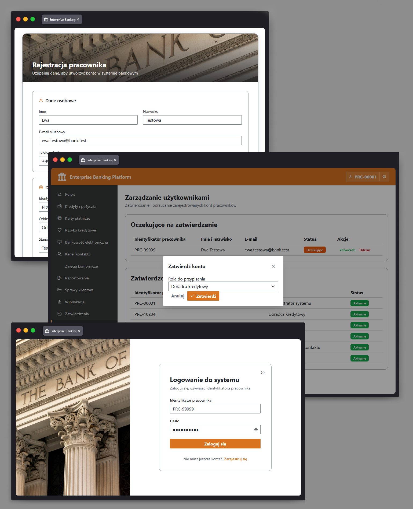
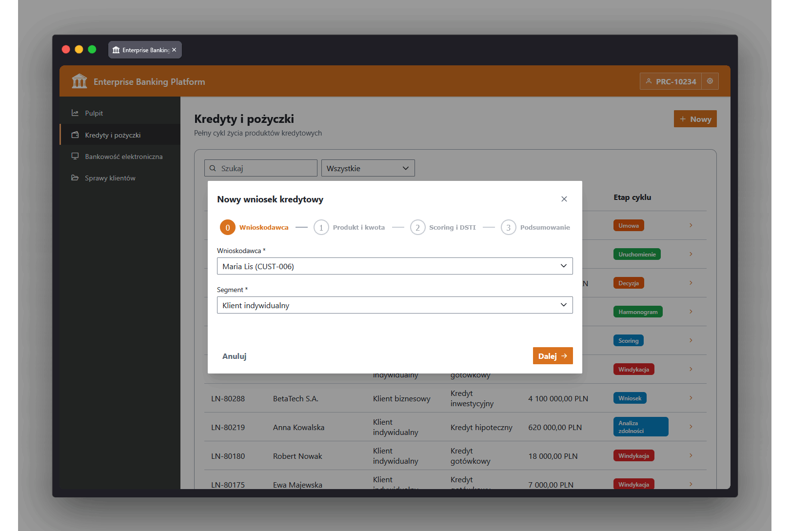
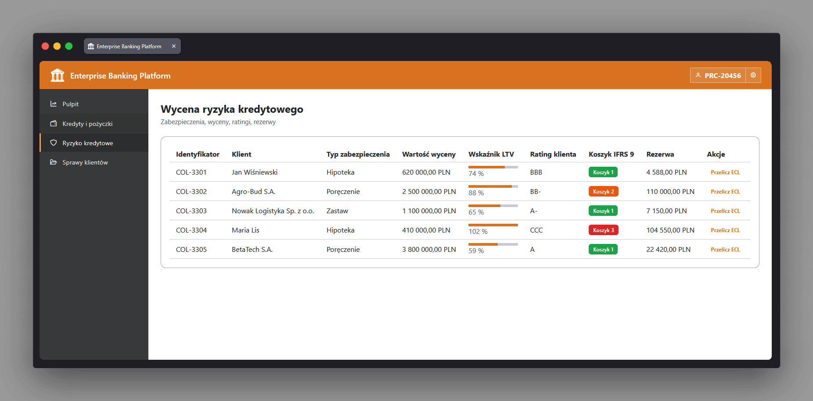
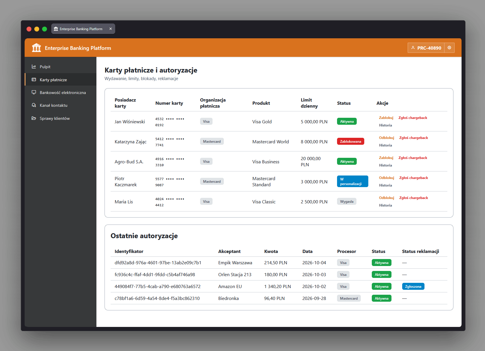
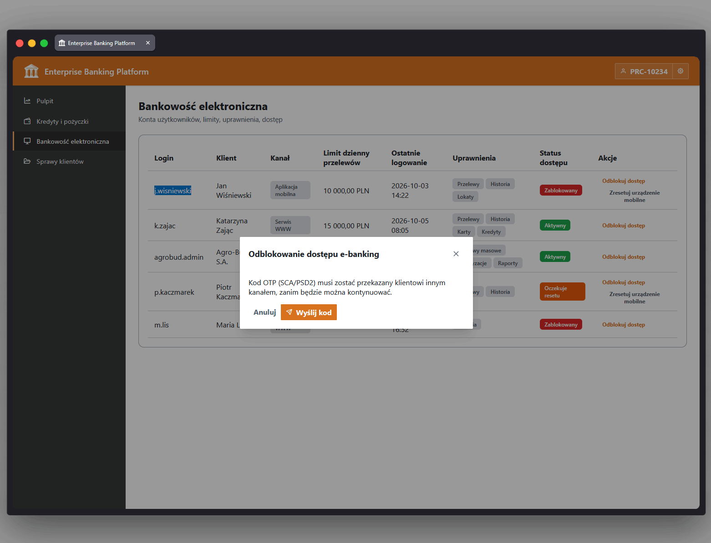
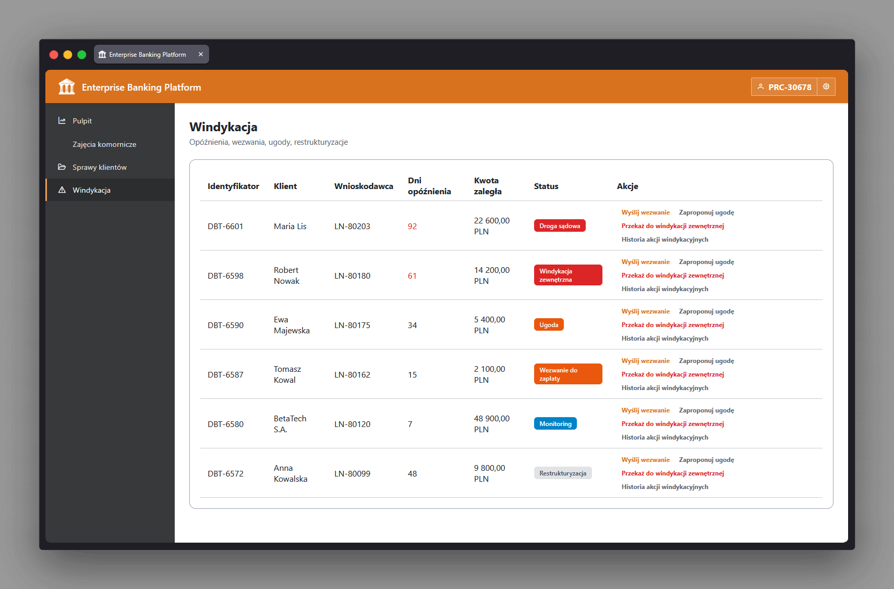
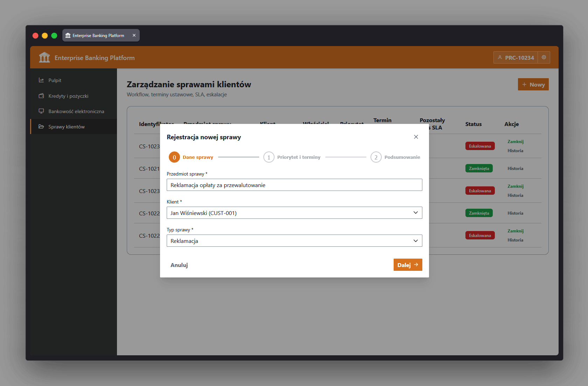

  

<h1 align="center">Enterprise Banking Platform</h1>

Enterprise Banking Platform (EBP) to modułowy system typu core-banking, modelujący back office banku detalicznego wraz z symulacjami instytucji zewnętrznych, z którymi się integruje. System obejmuje pełen cykl codziennych operacji bankowych — zarządzanie klientem i kontem, udzielanie kredytów, obsługę kart płatniczych, ocenę ryzyka kredytowego, bezpieczeństwo bankowości elektronicznej, egzekucję komorniczą, raportowanie regulacyjne oraz obsługę spraw klientów — wymuszając przy tym zasadę podwójnej kontroli (maker-checker) dla każdej istotnej operacji.

  
   
  

## Zastosowane standardy bankowe

Platforma implementuje lub symuluje następujące standardy bankowe i regulacje finansowe:

- **IFRS 9** — klasyfikuje ekspozycje na ryzyko kredytowe do stage 1/2/3 oraz wylicza rezerwy na straty dla zabezpieczeń kredytowych.
- **PSD2 / SCA (Strong Customer Authentication)** — wymaga weryfikacji kodem jednorazowym przed wykonaniem wrażliwych operacji bankowości elektronicznej (odblokowanie dostępu, reset urządzenia).
- **FATCA (Foreign Account Tax Compliance Act)** — eksportuje raporty XML o kontach rezydentów podatkowych USA do symulowanej bramy urzędu skarbowego.
- **CRS (Common Reporting Standard)** — eksportuje analogiczne, międzynarodowe raporty podatkowe OECD, korzystając z tego samego mechanizmu co FATCA.
- **DORA (Digital Operational Resilience Act)** — prowadzi rejestr incydentów ICT z poziomami istotności, widoczny na panelu operacyjnym.
- **Nadzór KNF** — przekazuje zgłoszenia sprawozdawcze do symulowanej bramy krajowego nadzoru finansowego.
- **Raportowanie do NBP** — przekazuje sprawozdania do banku centralnego, w tym przykładowe sprawozdanie płynnościowe.
- **BFG** — przekazuje zgłoszenia do funduszu gwarantującego depozyty przez tę samą bramę sprawozdawczą.
- **LCR / NSFR (wskaźniki płynności Bazylea III)** — uwzględnione w treści przykładowego sprawozdania płynnościowego przekazywanego do NBP.
- **AML / Compliance** — dedykowana rola użytkownika „Compliance / AML" uczestnicząca w procesie zatwierdzania maker-checker.
- **Reguły schematów kartowych (Visa/Mastercard)** — standardowe kody przyczyn chargebacku (np. 4855, 4837, 4853, 4863) używane w procesie obsługi reklamacji kartowych.

## Co robi EBP

- **Uwierzytelnianie i uprawnienia** — kontrola dostępu oparta na rolach i poziomach seniorstwa (Administrator, Compliance, Kredyty, Ryzyko, Windykacja, Obsługa klienta), obsługiwana przez dedykowany serwis tożsamości.

  

- **Zatwierdzenia maker-checker** — każda istotna operacja (zatwierdzenie kredytu, transfer środków, wypłata z egzekucji) musi zostać zatwierdzona przez inną osobę niż ta, która ją zainicjowała — reguła wymuszona po stronie serwera.
- **Udzielanie kredytów** — przyjęcie wniosku, scoring w biurze informacji kredytowej, proces zatwierdzania oraz generowanie harmonogramu spłat rat annuitetowych.

  

- **Zarządzanie ryzykiem kredytowym** — klasyfikacja i tworzenie rezerw zgodnie z IFRS 9 dla zabezpieczeń, a także obsługa spraw i działań windykacyjnych.

  

- **Zarządzanie kartami** — blokowanie/odblokowywanie kart oraz zgłaszanie i rozstrzyganie chargebacków, z eskalacją incydentu przy niedostępności operatora kart.

  

- **Bezpieczeństwo bankowości elektronicznej** — procesy chronione kodem jednorazowym (OTP/SCA) do odblokowywania dostępu klienta i resetowania zarejestrowanych urządzeń.

  

- **Egzekucja komornicza** — rejestracja zajęć majątkowych, blokowanie środków oraz rozliczenia kontrolowane zasadą maker-checker.

  

- **Raportowanie regulacyjne** — przekazywanie sprawozdań do bram KNF/NBP/BFG oraz eksporty podatkowe FATCA/CRS.
- **Obsługa spraw klientów** — obsługa reklamacji z wyliczaniem ustawowych terminów oraz automatyczną lub manualną eskalacją na podstawie SLA.

  

- **Panel operacyjny** — kluczowe wskaźniki płynności i portfela, alerty regulacyjne oraz najważniejsze incydenty ICT w jednym miejscu.
